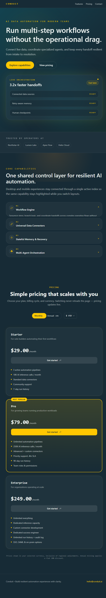
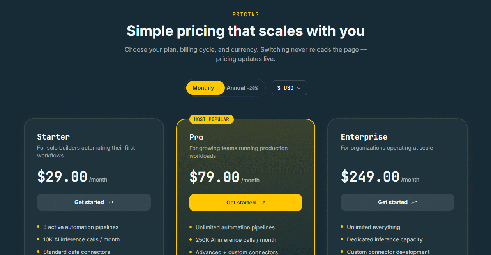

# Conduit — AI Data Automation Platform

A responsive SaaS landing page for a fictional AI data automation product, built in 4 hours for **Frontend Battle 3.0 (Round 1) at IIT Bhubaneswar** on 26 June 2026.

**Live demo:** https://frontend-vibecoding.vercel.app



## What this is

The brief was a premium landing page with a few hard rules: no UI or animation libraries, tight performance limits, and a 4-hour clock. I focused on two features where the engineering matters most, and kept everything else simple.

## Core features

### 1. Matrix-driven pricing and currency switcher

- 3 tiers × Monthly/Annual × USD/INR/EUR, all computed from one pricing matrix
- 20% annual discount multiplier and regional tariff variables, with no hardcoded prices
- Switching currency or billing cycle updates only the price text nodes, through a small plain-JS pub-sub store that lives outside React. The parent components don't re-render, and I checked this with a `MutationObserver`.



### 2. Bento grid that becomes an accordion (with context lock)

- Desktop: asymmetric bento grid
- Mobile: touch-friendly accordion
- Both views share one `activeIndex`, so if you resize the window, the active bento card maps straight to the open accordion panel


## Tech stack

- React + Vite 5
- Tailwind CSS v4 (no config file, just an `@theme` block in CSS)
- Plain CSS animations and transitions
- No Framer Motion, Radix, shadcn/ui or Headless UI

## Performance and accessibility

- Entry animation total ≤ 500ms
- No layout thrashing and no global re-renders
- Semantic HTML: one `h1`, landmark elements, crawlable text

## Design decisions

- **Pub-sub store outside React (`src/data/pricingStore.js`).** Prices change often and only affect text, so I kept them out of React state. That avoids re-rendering the whole pricing section on every toggle.
- **One shared `activeIndex`.** Rather than keep separate state for the bento and the accordion, both read the same value. That's what makes the resize behaviour work without any syncing code.
- **CSS over JS for motion.** All animation is CSS, which keeps the entry animation inside the 500ms budget.

## Run locally

```bash
git clone https://github.com/najmabegum-dev/conduit-landing-page.git
cd conduit-landing-page
npm install
npm run dev
```

Then open the local URL Vite prints (usually http://localhost:5173).

To make a production build:

```bash
npm run build
npm run preview
```

## Project structure

```
conduit-landing-page/
├── public/                  static assets
├── src/
│   ├── assets/icons/        icon files
│   ├── components/
│   │   ├── features/
│   │   │   ├── FeaturesSection.jsx   holds the shared activeIndex
│   │   │   ├── BentoGrid.jsx         desktop layout
│   │   │   └── AccordionList.jsx     mobile layout
│   │   ├── pricing/
│   │   │   ├── PricingSection.jsx
│   │   │   ├── PricingCard.jsx
│   │   │   ├── BillingToggle.jsx     monthly / annual
│   │   │   ├── CurrencySwitcher.jsx  USD / INR / EUR
│   │   │   ├── PriceText.jsx         subscribes to the store
│   │   │   └── PeriodText.jsx
│   │   └── icons.jsx        shared icon components
│   ├── data/
│   │   ├── pricingMatrix.js  tiers, prices, discount and regional multipliers
│   │   ├── pricingStore.js   pub-sub store (lives outside React)
│   │   └── features.js       feature card content
│   ├── App.jsx
│   ├── index.css            Tailwind v4 theme and global styles
│   └── main.jsx
├── index.html
├── .oxlintrc.json           linter config
├── package.json
└── vite.config.js
```

## License

MIT. See [LICENSE](LICENSE).
